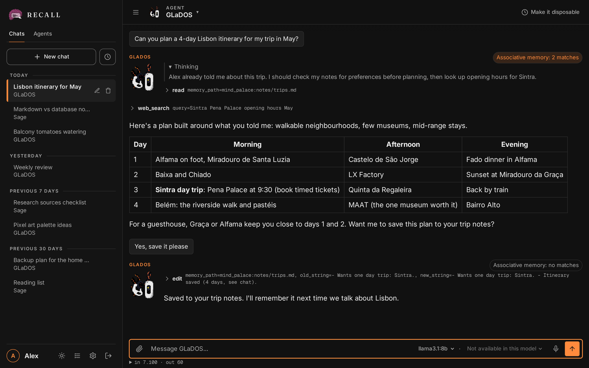
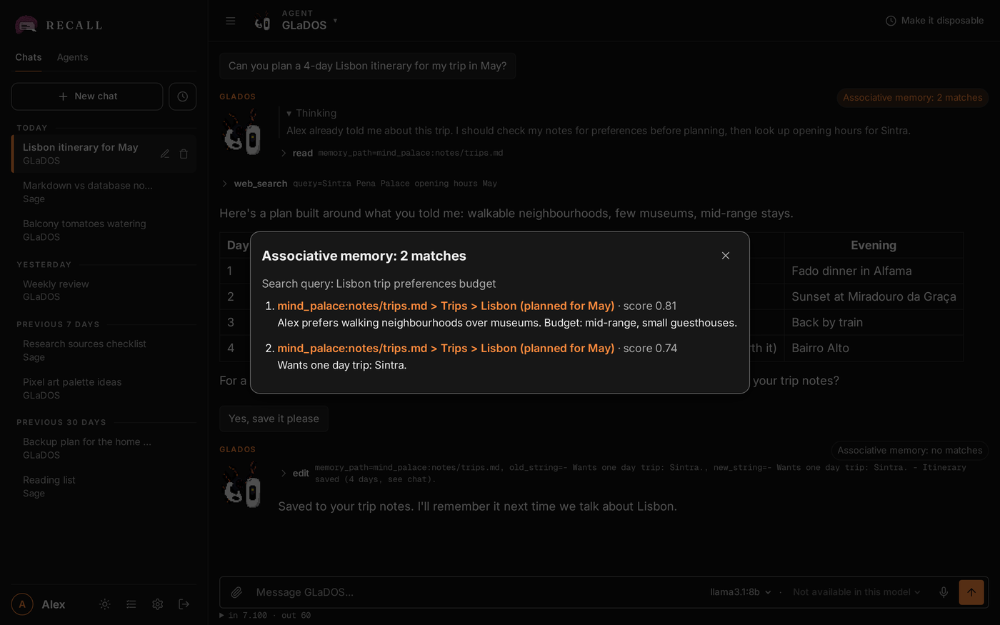
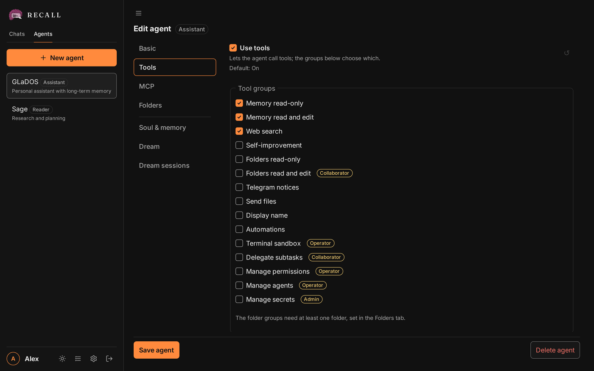
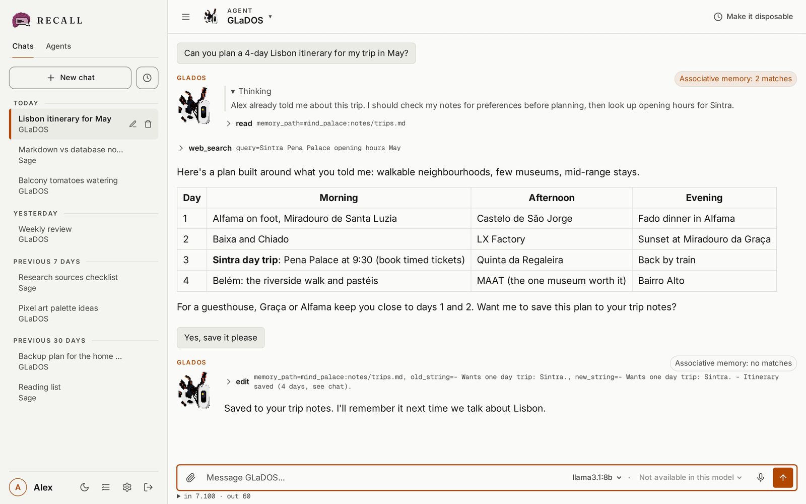
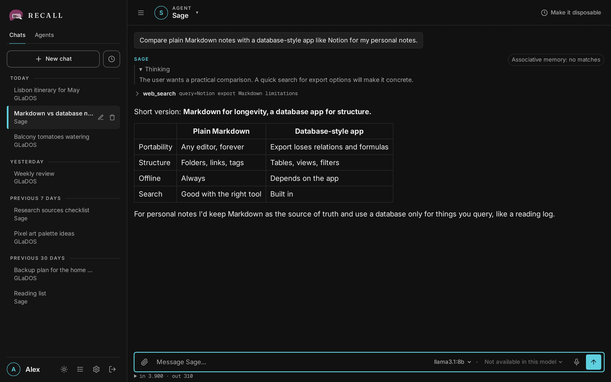

<div align="center">

# RECALL

**Self-hosted AI assistants that remember.**
Per-user agents with long-term memory, tools and their own personality, reachable from the web or Telegram.

</div>




## Why would you use RECALL?

- **Memory that works on its own.** While the agent writes, a vector search is made over its notes, skills and past chats. Any relevant fragments are slipped into the reply as hints. You can open them and see exactly what was recalled and why. This feature was inspired by human **associative memory**, which brings up related information based on stimuli. It's still a work in progress, but it already works well for many use cases.
- **Agents that look after themselves.** Each agent keeps a private *mind palace* (Markdown notes it organises), its own `SOUL.md` personality and its skills. In *dream mode* it reviews recent conversations and tidies its own files in the background.
- **Real tools, with you in control.** Memory, web search, user folders (an Obsidian vault, for instance), MCP servers, sandboxed terminals and subagents, chosen per agent. Permission levels and approval cards decide what runs without asking.
- **Multi-user by design.** Every user owns their agents, data and provider key; nothing is shared implicitly.
- **Yours to host.** Your server, your data, your models: OpenRouter, a local Ollama or (experimental) your own Claude login. No telemetry.

## A closer look

| Associative memory | Agent settings |
|---|---|
|  |  |
| What the agent recalled for this reply, from which note, and how close it was. | Tool groups per agent; each shows the permission level it needs. |

Every agent can have its own picture (here, pixel art) or a coloured initial, and the interface takes any accent colour, in a light or dark theme.

| Light theme, agent with a picture | Another agent without a picture, cyan accent |
|---|---|
|  |  |

## Features

- **Chat everywhere**: web UI (streaming, file and image input, voice notes, light/dark themes, custom accent colours, agent pictures), [Telegram bot](docs/user-guide/telegram.md) and a terminal client.
- **Memory**: [mind palace, memories and skills](docs/user-guide/memory.md), [associative memory](docs/architecture/associative-memory.md), long-chat [compaction](docs/reference/agent-yaml.md).
- **Dream mode**: [background self-curation](docs/user-guide/dream.md), scheduled or on demand.
- **Tools**: memory and self-editing tools, web search (Tavily), [user folders](docs/user-guide/agents.md), [MCP servers](docs/user-guide/mcp.md) such as Google Calendar, [terminals](docs/user-guide/terminal.md) on sandboxes or your own machines with approvals, [subagents](docs/user-guide/delegation.md) and [automations](docs/user-guide/automations.md).
- **Files and media**: PDFs (with OCR for scans), images, audio and video. See [files and media](docs/user-guide/files-and-media.md).
- **Models**: [OpenRouter, Ollama and the Claude subscription](docs/user-guide/models-and-providers.md), chosen per user or per agent.
- **Safety**: [permission levels and approval rules](docs/architecture/permissions.md), per-user secrets the agents never see, an [admin CLI](docs/user-guide/admin-cli.md).

## Quick start

### Docker (recommended for a server)

```bash
# 1. get the Compose file and the example settings
curl -O https://raw.githubusercontent.com/Lucasas126/RECALL/main/docker-compose.yml
curl -o .env https://raw.githubusercontent.com/Lucasas126/RECALL/main/.env.deploy.example
chmod 600 .env          # then fill it in

# 2. state folders, owned by the container user
mkdir -p config data logs && sudo chown -R 1000:1000 config data logs

# 3. add a user in config/<user_id>/ (see the installation guide), then start
docker compose up -d
```

The web UI listens on `http://<server>:8000`. Watchtower keeps it on the latest release. Full guide: [Docker deployment](docs/deployment/docker.md).

### From source

Requirements: Python 3.12+ and [uv](https://docs.astral.sh/uv/).

```bash
git clone https://github.com/Lucasas126/RECALL.git && cd RECALL
uv sync
cp -r .config/example_user .config/<user_id>   # edit user.yaml: id, name, provider key name
uv run python -m src.web.auth                   # prints the password hash for user.yaml
uv run python web.py                            # http://127.0.0.1:8000
```

Step by step, including the `.env` file and the Telegram bot: [installation and first run](docs/getting-started/installation.md).

## Documentation

Start at the [documentation map](docs/README.md).

- Using an existing install: [new user guide](docs/getting-started/new-user-guide.md)
- Setting RECALL up: [installation](docs/getting-started/installation.md), [Docker](docs/deployment/docker.md), [security](docs/deployment/security.md)
- Configuration: [settings.yaml](docs/reference/settings-yaml.md), [user.yaml](docs/reference/user-yaml.md), [agent.yaml](docs/reference/agent-yaml.md), [environment variables](docs/reference/environment-variables.md)
- How it works: [architecture overview](docs/architecture/overview.md)

## Project status

RECALL is under active development and changes quickly; configuration keys can change between minor versions (see the [changelog](docs/project/changelog.md) and the GitHub releases). Planned work lives in the [backlog](docs/project/backlog.md).

## Why did I build RECALL?

Of course, there are many agent frameworks out there that are probably more mature and have more features. RECALL itself is heavily inspired by many other agent frameworks, such as [Hermes](https://github.com/nousresearch/hermes-agent). But I wanted to build one that:
- Had Obsidian at its core, with Markdown notes and a mind palace for each agent that you can explore. An agent can build its own knowledge base and skills, and recall them in context.
- Could run on a small server, with a web UI and a Telegram bot, and be self-hosted with your own data and models. No telemetry or third-party tracking.
- Could be configured per user and per agent, with permission levels and approval rules for tools, and a clear separation between framework settings and user/agent configuration.
- Could be extended with new tools, providers and models.

And of course I wanted to face the challenges that come with building a framework like this, and learn from them. As you can imagine RECALL was not completely built by hand, I used many AI tools to help me write the code (at some point RECALL itself became the main tool to build its own code), but the design is as much my own as I could make it. It obviously had my own needs in mind, but I hope it can be useful to others too.

All pixel-art images in the web UI and in this README were manually painted by myself using [Aseprite](https://www.aseprite.org/), so no stolen or AI-slop art here.

And finally, why not?

## License and credits

RECALL is released under the [MIT License](LICENSE).

- The experimental Claude subscription provider is adapted from the MIT-licensed plugin `claude-subscription-directsdk-experimental` (Copyright (c) 2026 Nous Research and contributors); see [claude subscription](docs/user-guide/claude-subscription.md).
- The web UI bundles the Fraunces, Inter and Geist Mono fonts under the SIL Open Font License 1.1 ([details](src/web/static/fonts/LICENSES.md)); nothing is loaded from a CDN.
- Scanned PDFs use [Tesseract OCR](https://github.com/tesseract-ocr/tesseract), installed separately ([how](docs/user-guide/files-and-media.md#tesseract-ocr)).
