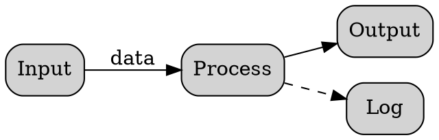
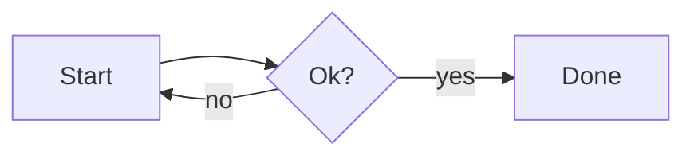
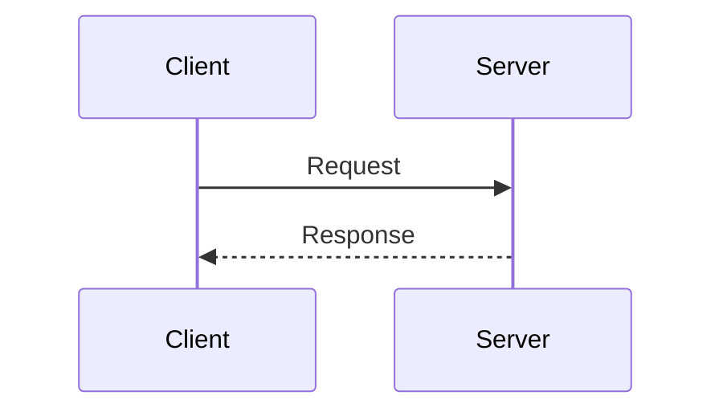
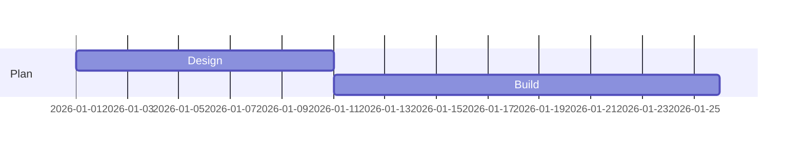
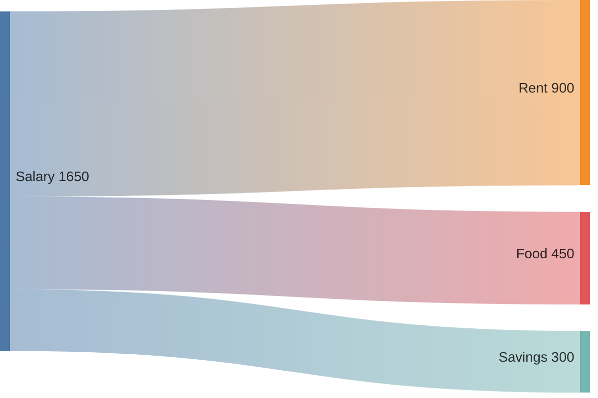

# Charts and diagrams

Tool group `charts` (opt-in, level `assistant`): `render_chart` and `render_diagram` draw a PNG into a source you may write. Nothing is sent.

- `render_chart(spec, path="", theme="dark", width=0, height=0, overwrite=false)`: `spec` is a Vega-Lite v5 JSON object with the rows inline in `data.values`. Remote or file data (`url`) is refused: no network, no file reads.
- `render_diagram(kind, source, path="", theme="dark", overwrite=false)`: `kind: "graphviz"` (DOT text) or `"mermaid"` (Mermaid text) as `source`.
- Default file: `mind_palace:charts/<title>.png`; a taken name gets `-2`, `-3`... unless `overwrite`. The path must end in `.png`. The result gives address and pixel size (rendered at 2x, at most 4000x4000).
- Themes: `dark` (default) and `light`, font Open Sans. Colours, fonts and sizes can be overridden in the spec's own `config` (it wins over the theme). In DOT, attributes you set win over the theme.
- Limits: spec 1 MB, DOT 200 KB, Mermaid 100 KB, a render time limit. Errors come back as `error: ...`; fix the input and retry.
- Missing Graphviz (`dot`) or Chromium (Mermaid) gives an error: tell the user it must be installed (`apt install graphviz chromium-headless-shell`; the Docker image has both).

## Workflow

1. `render_chart` / `render_diagram`. 2. `view_image` on the address: check labels, overlaps, colours. 3. Fix and re-render with `overwrite=true`. 4. `send_file` (group `files_send`) if the user wants it.

## Tips

- Give an explicit colour `scale.domain` so categories keep their colour. Panel size about 520x280.
- In `hconcat`/`vconcat` add `"resolve": {"scale": {"color": "independent"}}` or legends merge.
- Palette (dark): teal `#4FB3A6`, yellow `#E9C46A`, orange `#F4A261`, red `#E76F51`, green `#8AB17D`, blue `#7FA3B8`; background `#1B2230`.
- Data is neutral example data below; replace it with the user's.

## Recipes (Vega-Lite, each one tested)

Multi-series line over time:
```json
{"title":"Monthly totals","width":520,"height":280,"data":{"values":[{"m":"2026-01-01","k":"Food","v":300},{"m":"2026-02-01","k":"Food","v":340},{"m":"2026-03-01","k":"Food","v":310},{"m":"2026-01-01","k":"Travel","v":100},{"m":"2026-02-01","k":"Travel","v":60},{"m":"2026-03-01","k":"Travel","v":220}]},"mark":{"type":"line","point":true},"encoding":{"x":{"field":"m","type":"temporal","timeUnit":"yearmonth","axis":{"format":"%b","labelAngle":0,"title":null}},"y":{"field":"v","type":"quantitative","title":"Amount"},"color":{"field":"k","type":"nominal","title":null}}}
```

Horizontal sorted bar:
```json
{"title":"Spending by category","width":480,"data":{"values":[{"c":"Housing","v":900},{"c":"Food","v":450},{"c":"Travel","v":200},{"c":"Health","v":120}]},"mark":"bar","encoding":{"y":{"field":"c","type":"nominal","sort":"-x","title":null},"x":{"field":"v","type":"quantitative","title":null}}}
```

Donut (`stroke` = background colour; the pie is the same with `innerRadius` 0):
```json
{"title":"Share","width":300,"height":300,"data":{"values":[{"c":"Housing","v":900},{"c":"Food","v":450},{"c":"Travel","v":200}]},"mark":{"type":"arc","innerRadius":65,"stroke":"#1B2230"},"encoding":{"theta":{"field":"v","type":"quantitative"},"color":{"field":"c","type":"nominal","scale":{"domain":["Housing","Food","Travel"]},"title":null}}}
```

Pie:
```json
{"title":"Share","width":300,"height":300,"data":{"values":[{"c":"Housing","v":900},{"c":"Food","v":450},{"c":"Travel","v":200}]},"mark":{"type":"arc","stroke":"#1B2230"},"encoding":{"theta":{"field":"v","type":"quantitative"},"color":{"field":"c","type":"nominal","title":null}}}
```

Stacked bar:
```json
{"title":"Per quarter","width":480,"height":280,"data":{"values":[{"q":"Q1","k":"Housing","v":900},{"q":"Q1","k":"Food","v":450},{"q":"Q2","k":"Housing","v":900},{"q":"Q2","k":"Food","v":500}]},"mark":"bar","encoding":{"x":{"field":"q","type":"nominal","axis":{"labelAngle":0},"title":null},"y":{"field":"v","type":"quantitative","stack":"zero"},"color":{"field":"k","type":"nominal","scale":{"domain":["Housing","Food"]}}}}
```

Waterfall (rows `n` name, `a` start, `b` end, `t` type, `o` order):
```json
{"title":"Budget","width":480,"height":280,"data":{"values":[{"n":"Salary","a":0,"b":3000,"t":"Income","o":1},{"n":"Rent","a":3000,"b":2000,"t":"Expense","o":2},{"n":"Food","a":2000,"b":1500,"t":"Expense","o":3},{"n":"Left","a":0,"b":1500,"t":"Total","o":4}]},"mark":"bar","encoding":{"x":{"field":"n","type":"nominal","sort":{"field":"o"},"axis":{"labelAngle":0},"title":null},"y":{"field":"a","type":"quantitative","title":null},"y2":{"field":"b"},"color":{"field":"t","type":"nominal","scale":{"domain":["Income","Expense","Total"],"range":["#8AB17D","#E76F51","#E9C46A"]},"title":null}}}
```

Heatmap (colour range goes from the background colour to two palette colours):
```json
{"title":"Activity","width":420,"height":200,"data":{"values":[{"d":"Mon","h":"AM","v":3},{"d":"Mon","h":"PM","v":8},{"d":"Tue","h":"AM","v":5},{"d":"Tue","h":"PM","v":2}]},"mark":"rect","encoding":{"x":{"field":"d","type":"nominal","axis":{"labelAngle":0},"title":null},"y":{"field":"h","type":"nominal","title":null},"color":{"field":"v","type":"quantitative","scale":{"range":["#1B2230","#4FB3A6","#E9C46A"]},"title":null}}}
```

Line with a range band (area with `y`/`y2` at opacity .25 under the line):
```json
{"title":"Forecast","width":520,"height":280,"data":{"values":[{"x":1,"lo":8,"mid":10,"hi":12},{"x":2,"lo":9,"mid":12,"hi":16},{"x":3,"lo":9,"mid":13,"hi":19}]},"encoding":{"x":{"field":"x","type":"quantitative","axis":{"tickMinStep":1}}},"layer":[{"mark":{"type":"area","opacity":0.25},"encoding":{"y":{"field":"lo","type":"quantitative","title":null},"y2":{"field":"hi"}}},{"mark":{"type":"line","point":true},"encoding":{"y":{"field":"mid","type":"quantitative"}}}]}
```

Candlestick (`rule` low to high, `bar` open to close):
```json
{"title":"Price","width":480,"height":280,"data":{"values":[{"d":"Mon","lo":8,"hi":14,"o":10,"c":12,"t":"Up"},{"d":"Tue","lo":7,"hi":13,"o":12,"c":9,"t":"Down"},{"d":"Wed","lo":8,"hi":15,"o":9,"c":14,"t":"Up"}]},"encoding":{"x":{"field":"d","type":"nominal","axis":{"labelAngle":0},"title":null},"color":{"field":"t","type":"nominal","scale":{"domain":["Up","Down"],"range":["#8AB17D","#E76F51"]},"title":null}},"layer":[{"mark":"rule","encoding":{"y":{"field":"lo","type":"quantitative","scale":{"zero":false},"title":null},"y2":{"field":"hi"}}},{"mark":{"type":"bar","size":6},"encoding":{"y":{"field":"o","type":"quantitative"},"y2":{"field":"c"}}}]}
```

## Diagram recipe (Graphviz)


 
## Mermaid (`kind: "mermaid"`)

Tested: flowchart, sequence, Gantt, Sankey. Same themes; no network. Syntax errors come back as `error: invalid Mermaid: ...`: fix and retry. Gantt: wide charts are hard to read, use fewer tasks or a short date range (the image viewer has zoom). Sankey: `sankey-beta`, rows `source,target,value`; accents in names are fine.









Do not use `image`, `imagepath`, `fontpath`, `shapefile`, `stylesheet` or ``: diagrams cannot read files. Tool details: `references/tools-and-groups.md`.
